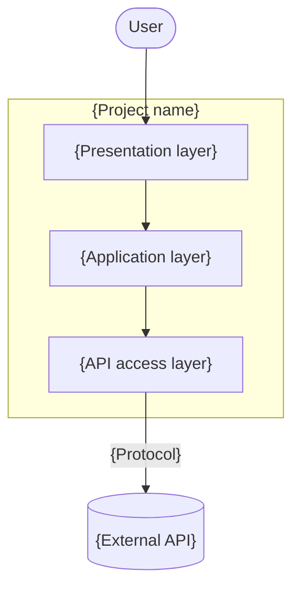

# {Project name}: Architecture Design Document

## Table of contents

- [Tech stack & dev tools](#tech-stack--dev-tools)
- [System architecture](#system-architecture)
- [Data model](#data-model)
- [Architecture Decision Records](#architecture-decision-records)

## Tech stack & dev tools

**Tech stack**:

- {Language, runtime or library}: {what it is used for}

**Dev tools**:

- {Build, test or other tool}: {what it is used for}

## System architecture

{Describe the layers and each layer's responsibility in a few sentences.}

<!-- Adapt the layers to the design, and keep the external API in the diagram. -->

## Data model

<!-- Describe the data in words. Do not include code. -->

### Entities

| Entity   | Fields                 | Description            |
|----------|------------------------|------------------------|
| {Entity} | {field, field, field}  | {What it represents.}  |

### DTOs

| DTO   | Direction         | Fields                | Maps to  |
|-------|-------------------|-----------------------|----------|
| {DTO} | {Request/Response} | {field, field, field} | {Entity} |

## Architecture Decision Records

<!-- Status: proposed, accepted, superseded or deprecated. -->

| ID     | Decision     | Reason     | Consequences     | Status   |
|--------|--------------|------------|------------------|----------|
| ADR-1  | {Decision.}  | {Reason.}  | {Consequences.}  | proposed |
