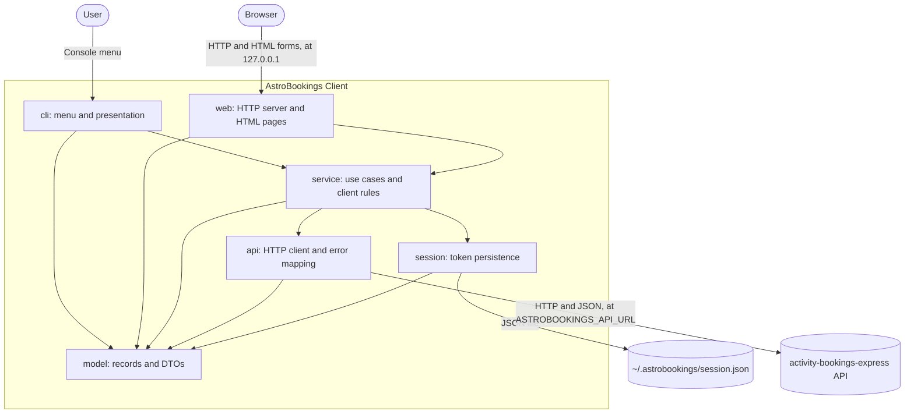

# AstroBookings Client: Architecture Design Document

## Table of contents

- [Tech stack & dev tools](#tech-stack--dev-tools)
- [System architecture](#system-architecture)
- [Data model](#data-model)
- [Architecture Decision Records](#architecture-decision-records)

## Tech stack & dev tools

**Tech stack**:

- Java 21: language and runtime, with records for the model (TR1).
- `java.net.http.HttpClient`: HTTP calls to the API (TR2).
- `com.sun.net.httpserver`: the JDK HTTP server behind the web interface (FR10, ADR-14).
- Jackson (`jackson-databind`): JSON for the API and for the session file (TR3).
- activity-bookings-express: external REST API, the client's only backend.

**Dev tools**:

- Maven through the Maven Wrapper: build and dependencies (TR1).
- JUnit 5: unit and end-to-end tests (TR8).
- `com.sun.net.httpserver`: also the in-memory fake HTTP server for unit tests (ADR-5).
- `maven-surefire-plugin`: selects tests by the `e2e` tag (ADR-5, ADR-9).
- `exec-maven-plugin`: runs the client from Maven (ADR-6).
- `maven-shade-plugin`: packages the executable jar with Jackson inside (ADR-8).

## System architecture

The client is a single-process application with two interfaces, a console menu and a web
interface, split into six layers under `dev.iman.astrobookings`. `Main`, in the root package,
sits outside the layers: it reads the API URL from `ASTROBOOKINGS_API_URL`, starts one interface
or the other and wires the layers together (ADR-4, ADR-7, ADR-16).

| Layer     | Responsibility                                                                                                  | Traces to                    |
|-----------|-----------------------------------------------------------------------------------------------------------------|------------------------------|
| `cli`     | Console menu, prompts, input validation and terminal output. It is the only layer that reads or prints there.   | FR1 to FR9, TR7, TR9         |
| `web`     | Browser interface: HTTP server, HTML pages and forms, and the presentation of each browser request (ADR-14).    | FR10, TR7, TR9               |
| `service` | Use cases and client rules: status filter, seats check, date display, session lifecycle, API failure meanings.  | FR1 to FR10                  |
| `api`     | HTTP calls, JSON mapping, Bearer header, activity-to-launch translation and mapping of API errors.               | TR2, TR3, TR4, TR6, TR7, TR9 |
| `model`   | Records for Launch, Booking, Session and their DTOs, plus the failure types shared by the layers.                | TR3, TR4                     |
| `session` | Reads, writes and deletes the session file.                                                                      | FR3, FR4, TR5                |

Dependencies point one way only: `cli` and `web` each call `service`, and `service` calls `api`
and `session`. `cli` and `web` do not know each other. All of them use `model`, which depends on
no other layer. `api` and `session` do not know each other: `service` reads the token from
`session` and passes it to `api` on each authenticated call.

## Data model

The client stores no data apart from the session file. Everything else is read from the API
on each request. API fields not listed below are ignored (TR3).

### Entities

| Entity        | Fields                                                                                  | Description                                                                                                                                                                                  |
|---------------|-----------------------------------------------------------------------------------------|----------------------------------------------------------------------------------------------------------------------------------------------------------------------------------------------|
| Launch        | id, name, slug, price, date, duration, location, minParticipants, maxParticipants, status | A rocket launch as the customer sees it. Only `published` and `confirmed` launches are listed or bookable. The date stays as the ISO text the API sends, and `cli` formats it for display.  |
| LaunchSummary | name, slug, price, date, duration, location, status                                     | The launch data embedded in a booking. It has no id or participant limits.                                                                                                                  |
| Booking       | id, launchId, userId, participants, createdAt, paymentId, paymentStatus, launch         | Seats booked by a user. The payment status is pending, paid or refunded. The launch is a LaunchSummary, and is absent on a newly created booking, when `cli` shows the launch the user chose. |
| User          | username, email                                                                         | The person the session belongs to, used to show who is logged in. The API's user id is not used (see AuthResponse).                                                                         |
| Session       | accessToken, username, email                                                            | The saved session, stored as JSON in `~/.astrobookings/session.json`. The password is never stored. The 24 h expiry is not stored, because the API decides it (ADR-11).                      |
| ApiError      | status, message, fieldErrors                                                            | A failed API response. The status comes from the HTTP response. The list of field errors may be empty.                                                                                       |
| FieldError    | field, message                                                                          | One invalid field in a failed API response, such as `email` when the address is already registered.                                                                                          |

### DTOs

Only `api` reads or writes these DTOs (ADR-3). They keep the API's names, so in the code outside
`api` the word "activity" appears only in these DTOs.

| DTO                     | Direction | Fields                                                                                    | Maps to       |
|-------------------------|-----------|-------------------------------------------------------------------------------------------|---------------|
| ActivityResponse        | Response  | id, name, slug, price, date, duration, location, minParticipants, maxParticipants, status | Launch        |
| RegisterRequest         | Request   | username, email, password, terms (always true, sent only after the user accepts)          | User          |
| LoginRequest            | Request   | email, password                                                                           | User          |
| AuthResponse            | Response  | user (username, email), accessToken. Used by registration and login.                      | User, Session |
| CreateBookingRequest    | Request   | activityId, participants                                                                  | Booking       |
| BookingResponse         | Response  | id, activityId, userId, participants, createdAt, paymentId, paymentStatus, activity       | Booking       |
| BookingActivityResponse | Response  | name, slug, price, date, duration, location, status                                       | LaunchSummary |
| ErrorResponse           | Response  | message, errors                                                                           | ApiError      |
| FieldErrorResponse      | Response  | field, message                                                                            | FieldError    |

`POST /bookings` also uses BookingResponse, with `activity` absent and paymentStatus "paid".

## Architecture Decision Records

| ID     | Decision | Reason | Consequences | Status |
|--------|----------|--------|--------------|--------|
| ADR-1  | Organize the code in five packages under `dev.iman.astrobookings`: `cli` (console menu and presentation), `service` (use cases and client rules such as filtering by status), `api` (HTTP client with `java.net.http` and mapping of API errors), `model` (records for Launch, Booking, Session and their DTOs) and `session` (token persistence in `~/.astrobookings/session.json`). | Each concern can change and be tested on its own, without a framework (TR1). | Dependencies point one way, as shown in the diagram. Client rules such as FR1 and FR6 live only in `service`, not in the menu. | accepted |
| ADR-2  | The interface is an interactive console menu, with input and output injected as `InputStream` and `PrintStream`. | Tests can script a whole session and check what the user sees, with no real terminal. | `cli` never touches `System.in` or `System.out` directly: only `Main` passes them in. End of input ends the menu cleanly. Passwords are read with `System.console().readPassword()` when there is a real console, and from the injected `InputStream` when there is none, as in the tests. `Main` also does the console lookup and passes the console to `cli`, so a test run from a terminal still uses the injected stream. | accepted |
| ADR-3  | A Launch in the client equals an Activity in the API, and the translation happens only in the `api` layer (TR4). | The user's vocabulary stays consistent, and the API's naming is confined to one place. | `service` and `cli` deal only in launches. Activity DTOs sit in `model` (ADR-1), but only `api` may use them. The client's own texts say "launch". API error messages are shown as they are, with no substitutions, so one such as "Activity not found" can reach the user unchanged. | accepted |
| ADR-4  | The API URL comes from the environment variable `ASTROBOOKINGS_API_URL`, with `http://localhost:3000` as the default. | The client and its tests can point to an API elsewhere without a rebuild (TR2). | Every HTTP call uses the configured URL, and the TR9 message shows it: "API not reachable at", followed by the URL. `Main` reads the variable once: a blank value means the default, and an invalid one gives a readable error at startup, shown by `cli` without a stack trace, and the client exits with code 1. | accepted |
| ADR-5  | Unit tests use JUnit 5 with an in-memory fake HTTP server (`com.sun.net.httpserver`), so they do not depend on the API. End-to-end tests drive the menu against the real API, are tagged `@Tag("e2e")` and are excluded from the default `mvn test`. | `./mvnw test` stays fast and works anywhere (TR8), while the end-to-end tests still check the real API contract, including the constraints a fake cannot prove. | Unit tests start the fake server on a free local port and use a temporary session file. End-to-end tests need the API running and fail if it is not. They change the API's data: each run adds users and uses up seats. Running `git checkout db/` in the API's repository restores the data, and the API then needs a restart because it keeps its data in memory. Each run registers a unique email with a timestamp, and the tests check only the bookings they create and avoid a total price that is a multiple of 1000 unless they mean to test a rejected payment, which the API answers with a 402. Unit tests cover that case with the fake server. Reused ids after an API restart (PRD known limitations) can make a new user see old bookings. | accepted |
| ADR-6  | Run the client with `exec-maven-plugin` through `./mvnw exec:java`, and also package an executable jar with `Main` as its main class. | Maven is the quick way to run it during development, and the jar runs without Maven. | `exec:java` does not compile, so a clean checkout needs `./mvnw compile exec:java`. The plugin configures the main class, so `-Dexec.mainClass` becomes optional. The jar needs Jackson at runtime (ADR-8). | accepted |
| ADR-7  | `Main` is the composition root: it builds the layers with plain constructor injection and passes in the streams, the console when there is one, the API URL and the session file path. | ADR-2, ADR-4 and ADR-5 all need these values to be replaceable, and TR1 rules out a heavy framework. | Tests build the same layers with their own values and never touch the user's real session file. `Main` reads the configuration, wires the layers and returns the exit code, and `cli` does all the printing, including the invalid URL error, so `Main` holds no presentation or use-case logic. | accepted |
| ADR-8  | Build the executable jar with `maven-shade-plugin`, so that it contains Jackson. | A jar that only names its main class fails at runtime, because Jackson is not on the classpath. A single file is also the simplest to run. | `./mvnw package` produces one self-contained jar. `.gitignore` already covers `dependency-reduced-pom.xml`, which this plugin generates. | accepted |
| ADR-9  | Select the tests with a Maven profile named `e2e`: Surefire excludes the `e2e` tag by default, and `./mvnw test -Pe2e` runs only the tests with that tag. | A profile gives a short command that is easy to remember, and keeps TR8's `./mvnw test` unchanged. | `pom.xml` needs Surefire configuration and the profile, which the first implementation spec, `chore-build-setup`, adds. | accepted |
| ADR-10 | `api` turns every failure into one of three types, defined in `model` so that `cli` does not depend on `api`: API not reachable, unauthorized, and API error carrying an ApiError. `service` decides what each one means, and `cli` is the only layer that shows them. | The same 401 means different things by use case: bad credentials on login (FR2) and a rejected session elsewhere (FR5). Showing errors in one place guarantees no stack traces reach the user (TR7, TR9). | Connection failures and timeouts become the TR9 message. Capacity errors (FR7) carry their numbers in the message with no field errors, so `cli` shows the message as it is and the client does not parse it. A 402 "Payment could not be processed" from `POST /bookings` also has no field errors and maps to an API error with status 402. `cli` shows its message and states that no booking was created, and the client does not try to predict the gateway's rule. A field error on `email` during registration makes `cli` ask for the email again. A response that is not valid JSON becomes a generic API error, which matters when the URL is configurable (ADR-4). This extends `model` beyond records (ADR-1). | accepted |
| ADR-11 | `service` loads the session at startup and trusts it without calling the API. The token is checked only when an authenticated call is made. When such a call returns 401, `service` deletes the session file and `cli` asks the user to register again. A session file that cannot be read counts as no session, and the user is told. | The API has no endpoint to validate a token, and `GET /activities` is public. Only the API knows if a token is still valid, so the client does not calculate the 24 h expiry itself (FR3, FR5). | Starting the client makes no authenticated call and needs no working session. An expired session is found on the first booking action. A rejected token is not kept, so the next run does not fail the same way. `session` creates the folder when needed, and logging out with no file is not an error (FR4). | accepted |
| ADR-12 | `service` filters launches with an allow-list of `published` and `confirmed`, and uses it both for the list and before each booking. | The API accepts bookings on draft launches (PRD constraints) and also has the statuses `sold-out`, `done` and `cancelled`, none of which are bookable under FR1 and FR6. An allow-list also rejects any status added later. | Status stays plain text, so an unknown value cannot break parsing. The booking flow offers only launches from a fresh list. `cli` also checks that the seats are a whole number of at least 1, with 0 cancelling (ADR-13), since the API accepts fractions. | accepted |
| ADR-13 | Use numbered selection in console menus: when the user chooses an item from a displayed list, they choose it by its number in that list, never by its id. Entering 0 at a prompt of a booking or selection flow, including the seats prompt, cancels and returns to the menu, and an invalid number makes the client ask again. | Ids are API details, so the user should not have to type them. A number can only point at an item the client has just displayed, which keeps the choice within the list on offer, such as the launches that pass the ADR-12 filter (FR6, FR9). | `cli` resolves the number to the item in the list it displayed, so `service` and `api` still work with ids and never see the numbers. It applies today to choosing a launch to book (`feat-booking-creation`) and a booking to view (`feat-booking-retrieval`), whose specs hold the detailed criteria. Numbering covers only choices from a list, and a seats value is not one: apart from the 0 that cancels, it must pass its own check (ADR-12), or the client asks again with no request to the API. Asking again stops at end of input, which still ends the menu cleanly (ADR-2). | accepted |
| ADR-14 | Add a sixth package, `web`, a second interface layer built on the JDK HTTP server (`com.sun.net.httpserver`), with no frameworks. It reuses `service`, `api`, `model` and `session` and duplicates no logic: like `cli`, it calls `service` and uses `model`, and it reaches `api` and `session` only through `service`. `web` does not depend on `cli`, so `LaunchDateFormatter` and the whole-number seats check move from `cli` to `service`. The server uses its default executor, which handles one request at a time. | FR10 asks for the console's features in a browser, and TR1 rules out heavy frameworks. The JDK server needs no new dependency. `service` is the shared place because both interfaces already depend on it, and `model` stays limited to records and failure types. `SessionService` holds unsynchronized state, and handling one request at a time keeps it safe with no locks, which is enough for a single local user. | This extends ADR-1. Client rules such as the status allow-list stay in `service` (ADR-12). For browser requests, `web` plays the role that ADR-2, ADR-7 and ADR-10 give to `cli`, and that the Data model mentions: it is the layer that presents data and shows failures, including the TR9 message and a rejected session, and no stack trace reaches the browser. It says "launch" as ADR-3 requires. The seats check that ADR-12 places in `cli` now lives in `service`, and the 0 that cancels stays in `cli` as console behaviour (ADR-13). In `web`, 0 is simply an invalid number of seats. Numbered selection is for console menus (ADR-13), so `web` uses ids in its links and forms. A launch id from a form is looked up in a fresh list of bookable launches, and a Launch is never built from form fields, so ADR-12 also holds for a stale or forged form. A slow API call holds the other requests until it ends or times out. | accepted |
| ADR-15 | Pages are HTML generated on the server, with a single simple CSS file served from `src/main/resources`, and actions are POST forms, with no mandatory JavaScript. All text coming from the user or the API is HTML-escaped. A successful POST answers with a 303 redirect (Post/Redirect/Get). A password is never echoed back into a form. | This is the simplest way to offer the console's features with no framework or front-end build (TR1). API and user text can contain markup, so escaping stops it from running in the page. The redirect means that a reload cannot repeat a booking (FR6). | Every action that changes something (register, log in, log out, book) is a POST, and a GET changes nothing, so the check in ADR-17 covers them all. A failed POST does not redirect: it shows the form again with the error, the other typed values escaped and the password empty, so the user can correct it. Escaping also applies to values inside HTML attributes. API error messages stay verbatim apart from escaping (ADR-3). Redirects use relative paths, so the browser stays on the host the user opened. The CSS file travels inside the jar (ADR-8). | accepted |
| ADR-16 | `java -jar ... --web` starts the web interface, and without `--web` the console starts as before. The port comes from `ASTROBOOKINGS_WEB_PORT`, with 8080 as the default. An invalid or busy port gives a readable error and exit code 1, with no stack trace. In web mode, `Main` must not call `System.exit` after starting the server. | One jar serves both interfaces (ADR-8), and the existing way of starting the console does not change. A configurable port avoids conflicts with no rebuild, as ADR-4 does for the URL. Calling `System.exit` once the server has started would stop it straight away. | `Main` stays the composition root (ADR-7): it reads the argument and the port once, and a blank value means the default, as in ADR-4. A valid configured port is 1 to 65535. Tests that need a free port pass 0 directly to the server (ADR-18). The API URL check of ADR-4 also applies in web mode. Startup errors and the address of the running server go to the terminal, before any browser request, so `Main` passes them to `StartupErrorView` in `cli`, as it does for the invalid URL (ADR-7), and `web` still does not depend on `cli`. `main` calls `System.exit` only when the console ends or startup fails. Otherwise, the process keeps running until the user stops it. Web mode does not read standard input. | accepted |
| ADR-17 | The web interface keeps the console's session model: a single local user with `~/.astrobookings/session.json`, not multiple users. Because the server acts with the user's saved token, it listens only on 127.0.0.1, and a POST whose `Origin` header is present and is not the server's own origin is rejected with 403. | The PRD scopes the web interface to one local user (FR10). Without these limits, another machine could use the token, or another website could submit a form to localhost and book seats in the user's name. | The same `SessionService` and session file are used, so ADR-11 applies: the server loads the session once at startup, an unreadable file counts as no session and the user is told, and a 401 on an authenticated call deletes the file. There is no login per browser, so every browser and program on this machine that reaches the port acts as that user. A console running at the same time shares the file, but the server does not see its changes until it restarts. The server's own origins are `http://127.0.0.1:<port>` and `http://localhost:<port>`, with the port actually bound, because the user can open either address. They are a fixed list and are not derived from the `Host` header, which an attacker's domain could control. The 403 comes before any `service` call. A POST with no `Origin` is accepted. GET requests are not checked: they change nothing, but a DNS rebinding page could read their responses, because this design does not check `Host`. | accepted |
| ADR-18 | Test the web interface with unit tests of the handlers, plus end-to-end tests that start the web server on a free port (port 0) and make real HTTP requests against the real API, tagged `@Tag("e2e")`. Tests use a temporary session file and stop the server when done. Behaviour the real API cannot reach, such as a successful login, is covered by unit tests with the fake server. | The browser path has its own risks, such as redirects, escaping and the `Origin` check, which only real HTTP requests prove. Port 0 avoids conflicts between runs, and the real API still checks the contract (TR8). | This extends ADR-5, whose end-to-end tests drive the menu: those stay, and these drive the web server instead. ADR-5's rules on API data apply to them too: a unique email on each run, only the bookings they create, and no total price that is a multiple of 1000 unless a test means it. The fake server also covers the 402 in unit tests, as in ADR-5. The existing `e2e` profile selects them, so `pom.xml` needs no test configuration change (ADR-9). The server's port and session file come from the composition (ADR-7), so tests never touch the user's real session file. | accepted |
